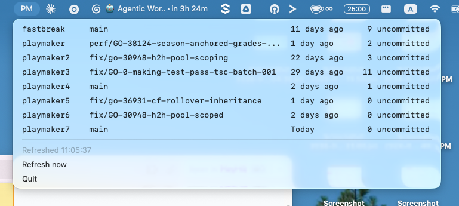

# repo-glance

A macOS menu-bar app that shows the git status of each of your local repo checkouts at a glance — current branch, how long since the last commit, and the number of uncommitted changes. Click a repo to jump to its [cmux](https://cmux.com) workspace.

It discovers repos by scanning folders you configure (e.g. `~/dev`, `~/dev2`) for directory names matching one or more regexes (e.g. `playmaker\d*`, `fastbreak\d*`).



---

## Install with an AI agent

Paste this into an agent (e.g. Claude Code) running in a terminal on your Mac:

```
Install and configure the repo-glance menu-bar app from this repo for me.

1. Make sure `uv` is installed (https://docs.astral.sh/uv/). If not, install it.
2. From the repo root, run `uv sync` to create the venv and install dependencies.
3. Run `uv run main.py --cli` once to generate the default config at
   ~/.config/repo-glance/config.toml, then Ctrl-C to stop.
4. Ask me which folders my repos live in and what naming pattern(s) they follow,
   then edit ~/.config/repo-glance/config.toml accordingly:
     - scan_dirs: the folders to scan (supports ~ and $ENV_VARS)
     - repo_pattern: a regex string, or a list of regexes; a directory is shown
       if its name FULLY matches any of them
   Leave refresh_seconds and title at their defaults unless I ask otherwise.
5. Launch the menu-bar app with `uv run main.py --no-cli` and confirm my repos
   appear in the menu-bar dropdown.
```

---

## Requirements

- **macOS** (it's a menu-bar app; uses `rumps` + AppKit)
- **Python 3.11+** (uses the stdlib `tomllib`)
- [**uv**](https://docs.astral.sh/uv/) for dependency management
- *(optional)* [**cmux**](https://cmux.com) — only needed for the click-to-open-workspace feature

## Manual install

```sh
uv sync                  # create .venv and install dependencies
uv run main.py           # run it
```

## Running

| Command | Mode |
| --- | --- |
| `uv run main.py` | Menu-bar app **and** prints a refreshing table to the terminal |
| `uv run main.py --no-cli` | Menu-bar app only (no terminal output) — best for running in the background |
| `uv run main.py --cli` | Terminal table only, no menu-bar icon (handy over SSH / for a first run) |

The menu bar shows a short title (default `RG`); click it to see your Claude/Codex usage, the per-repo status (with a PR line under each repo that has one), a "Refresh now" item, "Hide/Show PRs", "Edit config", "Open GitHub" (with how many commits behind the app's own checkout is), "Pull (update)" (updates the app itself via `git pull`; hot reload applies it within seconds), and "Quit".

### Usage row (Claude + Codex)

The first row shows how much of your current Claude 5-hour session limit you've used and when it resets (the bare time after the percentage) — the same numbers as Claude Code's own `/usage` — and, when `~/.codex/sessions` exists, your Codex CLI usage on the same line:

```
Claude ███░░░░░░░  28% 20:00  │  Codex ███░░░░░░░  28% 15/09
```

Click it to open your Claude usage settings. Codex usage is read locally from the newest `rollout-*.jsonl` session file (`payload.rate_limits.primary`) — no network, no auth. Codex reports whichever limit it considers primary (sometimes the 5-hour window, sometimes the weekly one), so the reset shows a time or a date accordingly; `0%` with no reset means the last recorded window has expired and Codex hasn't been used since.

It reads Claude Code's OAuth token from the login keychain, so **macOS asks for permission the first time** (choose "Always Allow" to avoid being asked again). repo-glance only reads the token; refreshing it stays Claude Code's job, so if the token has expired the row reads `usage unavailable` until Claude Code next runs. Set `show_usage = false` in the config to hide the row.

#### Several Claude logins

If you run Claude Code under more than one `CLAUDE_CONFIG_DIR` (say a work login in `~/.claude` and a personal one in `~/.claude-ak`), list the dirs in `claude_dirs` and each login gets its own segment on the same row. Give them short labels with the table form, and shorten the Codex one with `codex_label`:

```toml
claude_dirs = { A = "~/.claude", "A(2)" = "~/.claude-ak" }
codex_label = "GPT"
```

```
A ███░░░░░░░  31% 21:00  │  A(2) ░░░░░░░░░░   0% 01:20  │  GPT ████░░░░░░  36% 02/11
```

Claude Code keeps each config dir's token in its own keychain item (`Claude Code-credentials` for `~/.claude`, otherwise `Claude Code-credentials-<first 8 hex of sha256(absolute dir path)>`), so macOS asks for permission once per dir. Each login is polled on its own 5-minute timer, and the stale/`unavailable` rules above apply per segment. WIP.md and WIP.json keep the full labels from `claude_dirs` but always call Codex "Codex".

### Behind-main section (temporary)

Under the usage row, two hard-coded lines track the Node 24 upgrade (`SYNC_*` constants in `rg/sync.py`): how far the remote PR branch and the local `playmaker9` checkout are behind `origin/main` — the cue that it's time to rebase.

```
PR #10405 (remote)       0 behind main, 528 ahead  [CI passed]
playmaker9 (local)       0 behind main, 528 ahead
```

The PR line also shows its CI state (`CI passed` / `CI running` / `CI failed`, via `gh`). `git fetch origin main <branch>` and the `gh pr view` run at most every 5 minutes (never a full fetch, never a credential prompt); the counts are computed locally on every refresh, so they update right after a rebase/push. Clicking the PR line opens it on GitHub; the local line opens the checkout in cmux. Delete it once the project lands (see *Temporary code* below).

### Hot reload

`main.py` is a thin launcher; all app logic lives in the `rg/` package, which `logic.py` hot-reloads on every tick (~2 s). Only files whose mtime changed are re-run — plus every module after the first changed one in `rg.MODULES`, since those hold references into it — so an unchanged tick costs ~0.3 ms. Edits to any `rg/*.py` file take effect within seconds without restarting the app — only changes to `main.py` itself need a restart. If you save a file with a syntax error in it, the app keeps running the last good version of *every* module and logs the error to stderr.

### Responsiveness

- The app opts out of **App Nap** (`NSActivityUserInitiatedAllowingIdleSystemSleep`, `_keep_awake` in `rg/app.py`). Without it macOS naps the idle menu-bar app — timers delayed by seconds, lower priority — and the first click after a quiet spell can take seconds to open the menu. The Mac can still sleep.
- Every menu open is timed from the click (`NSMenuDelegate.menuWillOpen:` vs the click event's timestamp). Opens slower than 150 ms (`SLOW_OPEN_MS`) are logged to `~/Library/Logs/repo-glance.log` (also in Console.app → Log Reports) with what was running: a refresh in progress and for how long, a cmux poll, the last tick's and reload's duration, App Nap state. An empty log means every open was fast.

### Change detection

The app ticks every 2 seconds, but each tick only stats a handful of files — the app's own code, `config.toml`, `state.json`, and each repo's `.git/HEAD`, `.git/index`, `.git/packed-refs`, and `.git/logs/HEAD`. A full refresh (git commands, menu rebuild) runs only when one of those changed, so commits, branch switches, staging, pulls, and config edits show up within ~2 s. Unstaged working-tree edits don't touch those files; they're picked up by the unconditional full refresh every `refresh_seconds`.

A refresh never blocks the UI: all git, `gh`, and network calls run on a background worker thread that produces a snapshot, and the main thread only turns the finished snapshot into menu items (a few milliseconds). A cold refresh — usage poll, PR lookups, and fetches all expire on the same 5-minute cadence — takes 10–15 s in the background; the previous menu stays up and responsive meanwhile. At startup the menu shows `Loading…` until the first snapshot lands.

## Configuration

On first run, a commented sample is written to `~/.config/repo-glance/config.toml`. Changes to the file are **detected within ~2 s**, so edits (including the menu title and refresh interval) take effect almost immediately — no restart needed.

| Key | Default | Description |
| --- | --- | --- |
| `scan_dirs` | `["~/dev", "~/dev2"]` | Folders to scan. `~` and `$ENV_VARS` are expanded. |
| `repo_pattern` | `"playmaker\\d*"` | A regex **string**, or a **list** of regexes. A directory is shown if its name *fully* matches any of them. |
| `hide_pattern` | `[]` | Regex string or list; a directory whose name *fully* matches any of them is hidden even if `repo_pattern` matches it. |
| `refresh_seconds` | `60` | Seconds between unconditional full refreshes. Git and config changes are detected within ~2 s regardless; this backstop also catches unstaged working-tree edits. |
| `title` | `"RG"` | The menu-bar title. |
| `sort` | `"name"` | Listing order: `"name"` (grouped by scan dir), `"oldest"` (oldest last commit first), or `"newest"` (most recent first). |
| `active_days` | `30` | Hide repos whose last commit is older than this. `0` shows all. |
| `branch_width` | `25` | Branch column width; longer names are truncated with `...`. |
| `show_usage` | `true` | The Claude/Codex usage row. |
| `claude_dirs` | `["~/.claude"]` | Claude Code config dirs (`CLAUDE_CONFIG_DIR` values) to show usage for, one row per login. A list derives labels from the dir names (`~/.claude-ak` → `Claude ak`); an inline table `{ A = "~/.claude", "A(2)" = "~/.claude-ak" }` sets short ones. |
| `codex_label` | `"Codex"` | Label of the Codex segment in the usage row. |
| `icon` | `""` | Path to a `.png`/`.svg` menu-bar icon instead of the title text (candidates in `docs/icons/`). |
| `wip_file` | `"~/.config/repo-glance/WIP.md"` | Markdown file rewritten after every refresh, and whenever a cmux agent changes state, with the menu's info (usage, behind-main, and a repo table with full paths, branches, PRs, tickets, and agent/important markers, nothing truncated) so other agents can read it. A `WIP.json` with the same data (`version: 1`; `usage.claude` is the first login in `claude_dirs`, `usage.claude_accounts` lists every login as `{label, usage}`; per repo: `name`, `path`, `branch`, `last_commit_date`, `uncommitted`, `important`, `agent` = `"running"`/`"waiting"`/`null`, `pr`, `ticket`) is written next to it. Both are written atomically, in menu-bar and `--cli` mode. Empty disables both. |

New keys added by an update are appended to an existing config file as commented blocks (`_append_missing_keys`), so they're discoverable without re-creating the file.

### UI state (`state.json`)

What the menu's toggles change lives in `~/.config/repo-glance/state.json`, which the app owns, so it never rewrites your hand-edited TOML:

```json
{ "important": ["playmaker6"], "show_pr": true }
```

| Key | Default | Set by |
| --- | --- | --- |
| `important` | `[]` | **Mark/Unmark important** in a row's context menu. Repo directory names shown with an orange `★` and a bold name. |
| `show_pr` | `true` | **Hide/Show PRs** in the footer. PR line under each repo (needs an authed `gh`). |

You can edit it by hand too (changes are picked up within ~2 s). Older builds kept these two keys in `config.toml`; if `state.json` doesn't have a key yet, the `config.toml` value is used, and the first toggle writes it to `state.json`.

Example with multiple patterns, oldest commits first:

```toml
scan_dirs = ["~/dev", "~/dev2", "~/work/$USER/projects"]
repo_pattern = ["playmaker\\d*", "fastbreak\\d*"]
refresh_seconds = 60
title = "RG"
sort = "oldest"
```

Notes:
- Patterns are matched against the directory **name only**, anchored as a full match (`^(?:…)$`), so `myrepo\d*` will not match `myrepository`.
- Problems never crash the app; they show as red `⚠` rows at the top of the menu (click one to open the file). A file that doesn't parse (e.g. a duplicate key) falls back to all defaults; a single bad value (an invalid regex, `refresh_seconds = "60"`) only resets that key. While `state.json` is unreadable — or `config.toml` doesn't parse and `state.json` doesn't exist yet — the toggles refuse to write and say why, so they can't overwrite your settings.
- Failed actions (for example the merged-PR cleanup below) and failed refreshes also show as red rows; click to dismiss.

## Repo rows: click, hover, right-click

Each repo row is `name  branch  age  ~dirty ▸`, optionally prefixed by markers: a green `◐` when Claude Code is working in one of that repo's [cmux](https://cmux.com) workspaces (a tab title shows its spinner), otherwise a red `✳` when Claude there sent "Claude is waiting for your input" and you haven't replied since (`AGENT_MARKS`), and an orange `★` plus a **bold** name when you've marked it important. Each marker column only appears while some repo uses it. Hovering it opens a submenu of actions; **left-click** jumps to cmux: for a `✳` row straight to the Claude tab that's waiting (`cmux open-notification`), for a `◐` row to the running agent's workspace, otherwise like *Open in cmux*.

| Action | What it does |
| --- | --- |
| ✳ Jump to waiting Claude / ◐ Jump to running agent | Only while the repo has an agent marker. Same as left-click. |
| Open in cmux | Focuses the existing [cmux](https://cmux.com) workspace whose cwd **is** that repo, or opens a new one; brings cmux to the front. No-op if cmux isn't installed. |
| Open in WebStorm / Open in Cursor | `open -a <App> <repo>`. Add more editors by appending to `CONTEXT_ACTIONS` in `rg/rows.py`. |
| Open in Codex | Opens the most recently updated, unarchived user chat for that checkout, or a new chat with the checkout selected. Reads the newest `state_*.sqlite` in `$CODEX_HOME` (default `~/.codex`) in read-only mode; excludes internal subagents and non-interactive sessions. If the index is missing or incompatible, opens a new chat. Requires the desktop app's `codex://` URL handler. |
| Open PR #N | Only when the branch has a PR (via `gh`). |
| Open GO-XXXXX | Only when a Jira key is found in the branch name or PR title (`_TICKET_RE`, `JIRA_BROWSE_URL`). |
| PR merged: switch to default branch & pull | Only when the branch's PR is merged. Switches to origin's default branch (`origin/HEAD`, else `main`/`master`) and runs `git pull --ff-only`, in the background. Refuses if the checkout has uncommitted changes; failures show as a red row. The merged branch itself is left alone. |
| ★ Mark important / Unmark important | Adds or removes the repo's name in `state.json`'s `important`. Starred rows get an orange `★` and a bold name (and a `★` in `WIP.md`/`WIP.json`). |

**Right-click / ctrl-click** closes the dropdown and pops the same actions as a context menu at the cursor. (It has to close the dropdown first — see *AppKit constraints* below.)

The PR line under a repo (`↳ PR #N  title  [CI failed, Approved]`) opens the PR; quiet states (open, CI green, no review yet) show no bracket.

## Development

Everything below is what you need to pick this project up in a fresh session.

### Layout

| File | Role |
| --- | --- |
| `main.py` | Thin launcher: owns the Cocoa event loop, the status item, and the 2 s `rumps.Timer`. Reloads `logic` on every tick and calls `logic.tick(app)`. **Needs a restart to change.** |
| `logic.py` | Hot-reload facade. On every reload it stats `rg/*.py`, compiles the changed ones, re-runs them and every later module in `rg.MODULES` order, and re-exports `tick`/`refresh`/`cli_tick`/`TICK_SECONDS` for the launcher. Its `_LOADED` mtimes survive its own reloads (`globals().setdefault`). |
| `rg/config.py` | `config.toml` + `state.json` loading (errors collected on `Config.errors`), `save_state`, paths and intervals. |
| `rg/notices.py` | Dismissible red rows for failed actions/refreshes, kept on the app object. |
| `rg/repos.py` | Repo discovery and sorting, per-repo git status, the change fingerprint, the merged-PR cleanup. |
| `rg/prs.py` | `gh pr view`, CI/review labels, Jira ticket keys. |
| `rg/sync.py` | The temporary behind-main section and this checkout's own behind-upstream count. |
| `rg/usage.py` | Claude (OAuth endpoint, one reading per `claude_dirs` login) and Codex (local session files) usage. |
| `rg/codex.py` | *Open in Codex* (latest chat lookup). |
| `rg/cmux.py` | cmux CLI: open/focus, per-repo `AgentState` (running/waiting), the `cmux events` reader. |
| `rg/snapshot.py` | `Snapshot`, the data everything renders from. |
| `rg/fmt.py` | Plain-text rows (markers gutter, columns), shared by the menu, `--cli`, and WIP.md. |
| `rg/wip.py` | WIP.md and WIP.json. |
| `rg/rows.py` | Repo row `NSView`s (draw, click, right-click), attributed text, row actions. |
| `rg/menu.py` | Builds the dropdown (problems, usage, rows, footer) and the footer actions. |
| `rg/app.py` | `tick`/`refresh`/collect/render, the cmux event watcher and poller. |
| `rg/cli.py` | `--cli` mode. |
| `tests/` | `unittest` suite (see *Tests*). |
| `run.bash` | `uv run main.py`. |
| `docs/` | README screenshot and menu-bar icon candidates. |

The app is usually already running while you edit. Save a file and the change is live within ~2 s; a syntax error anywhere keeps the previous version of everything running and prints a traceback to the launcher's stderr. Check with `pgrep -fl main.py`.

### Threading model — never block the main thread

`tick()` runs on the main thread (the one that draws the menu bar), so anything slow there freezes the whole app. The split is:

- **Worker thread** — `rg.app._collect(app)` builds a `Snapshot` (repos, PRs, usage, Codex, sync section, self-update count). Every `git`, `gh`, and network call lives here. A cold pass takes 10–15 s.
- **Main thread** — `tick()` renders a pending snapshot via `_build_menu(app, snap)` (~25 ms) and starts a new worker when the fingerprint changed or `refresh_seconds` elapsed. It never starts a second worker while one is alive.
- `refresh()` (startup, Refresh now, Hide/Show PRs) reloads config, re-renders the *existing* snapshot immediately so toggles feel instant, then starts a worker.
- **cmux threads** — a long-lived reader runs `cmux events --reconnect` (categories agent/notification/workspace, minus the per-tool-call `PreToolUse`/`PostToolUse` hooks) and only sets `_rg_cmux_dirty`. `tick()` then starts a short-lived poller that recomputes agent state; the poller also runs every 60 s as a backstop, or every 5 s if the event stream isn't available (restarted at most every 30 s).

Rule of thumb: if a function calls `subprocess` or `urllib`, it belongs in `_collect` or something it calls, and its result goes into `Snapshot`. `_build_menu` must stay pure rendering. Slow lookups are rate-limited to `FETCH_SECONDS` / `USAGE_SECONDS` (5 min) with timestamps cached on the app object; local `rev-list` counts run every pass so they self-correct immediately after a pull/rebase.

### State lives on the `app` object

Module globals are re-initialised on every reload, so anything that must survive is an `app._rg_*` attribute: `_rg_snapshot`, `_rg_pending`, `_rg_worker`, `_rg_fingerprint`, `_rg_last_refresh`, `_rg_usage`, `_rg_pr_cache`, `_rg_sync_fetched`, `_rg_sync_pr`, `_rg_last_fetch`, `_rg_agent_states`, `_rg_cmux_worker`, `_rg_cmux_polled`, `_rg_cmux_dirty`, `_rg_cmux_watcher`, `_rg_cmux_watch_started`, `_rg_notices`, `_rg_activity`, `_rg_menu_delegate`, `_rg_menu_opens`, `_rg_tick`. (`cfg.CONFIG` is the one module global that's fine: it's re-read from disk on every reload.) Read them with `getattr(app, name, default)` — a freshly started app has none of them, and an older build may have left a different shape (see `_usage` for the defensive pattern).

### Hot-reload constraints

- `main.py` must never `from logic import x`; always go through the module attribute.
- An `rg` module may only import from modules listed **before** it in `rg.MODULES`; otherwise it would bind the previous version of the later module on every reload. `tests/test_app_state.py` enforces this. A new module must be added to `rg.MODULES`.
- `cfg.CONFIG` is reassigned by `refresh()`, so always read it as `cfg.CONFIG.x` (`from . import config as cfg`), never `from .config import CONFIG`.
- `cfg.CONFIG` is no longer re-read on every tick (unchanged modules aren't re-run); it's reloaded by `refresh()`, which the fingerprint triggers whenever `config.toml` or `state.json` changes.
- ObjC classes can't be re-registered (the same applies to `RGMenuDelegate1` in `rg/menu.py`). The row view class is created through `rg.rows._repo_row_view_class()`, which returns the existing class via `objc.lookUpClass` if it's already registered. Its methods are thin delegates to `rg.rows` functions (`_row_draw`, `_row_event`), so **behaviour** hot-reloads; if the class body itself must change (new method/ivar), or the delegates move to another module, bump the class-name suffix (now `RGRepoRowView3`). `logic.py` re-exports `_row_draw`/`_row_event` for rows built by the pre-split `RGRepoRowView2`.
- Long-lived threads (the `cmux events` reader) keep running the code they started with, but every name they call is looked up in the reloaded module, so keep them as thin loops that only set flags.
- The worker may be running the *previous* module's `_collect` while the main thread renders with the new `_build_menu`. Snapshots are plain data, so this is fine as long as you don't rename `Snapshot` fields without expecting one failed render (`_render` clears `_rg_pending` first so it can't loop).

### AppKit constraints learned the hard way

These cost a lot of trial and error; don't re-fight them.

- Plain `NSMenuItem`s **never fire on right-mouse-up**, and any item activation closes the dropdown. Hence rows are custom `NSView`s (`setView_`) that get raw mouse events.
- Items with no callback are auto-disabled by rumps, and **views inside disabled items get no mouse events** — every row keeps a callback (`_on_row_select`).
- A second menu-tracking session **cannot start while the dropdown's session is active**: `popUpContextMenu_withEvent_forView_` silently no-ops. The only way to show per-row actions with the dropdown open is a **submenu** (`setSubmenu_`), which runs inside the same session. The right-click fallback must `cancelTracking()` the dropdown, then pop the menu from a 0 s `NSTimer` so the tracking run loop has unwound.
- View-based items draw nothing themselves: highlight (`NSTrackingArea` enter/exit → `setNeedsDisplay_`), text, and the submenu arrow are all drawn in `_row_draw`. Row width is computed from the widest summary string (`_mono_attr(...).size()`).
- Keep strong references to submenus/context menus on the view (`_rg_keep`, `_rg_ctx_keep`) or they're collected while open.
- rumps keys menu items by title and silently drops duplicates — use explicit keys (`app.menu["<repo>:row"] = item`) for anything that can repeat.

### Data sources

| What | How | Cadence |
| --- | --- | --- |
| Repo status | `git log/rev-parse/status` per repo, 16-thread pool | every pass |
| PRs | `gh pr view --json …` in each repo (resolves the branch itself) | 5 min per (repo, branch) |
| Claude usage | `GET https://api.anthropic.com/api/oauth/usage` with the OAuth token from keychain item `Claude Code-credentials` (`security find-generic-password`) | 5 min; a 429 keeps the last reading flagged stale |
| Codex usage | newest `~/.codex/sessions/YYYY/MM/DD/rollout-*.jsonl`, last 64 KB, line containing `"rate_limits"` | every pass (local) |
| cmux agent state (`◐` / `✳`) | Three calls: `cmux rpc workspace.list` (workspace cwds), `cmux --json list-notifications`, and `cmux --json tree --all` (every tab's title). A workspace counts for a repo when its cwd is at or under it. **Running**: a terminal tab whose title starts with Claude Code's working spinner (`◐◓◑◒`, `CLAUDE_SPINNER`; idle tabs show `✳`). cmux's own `any_agent_running` flag isn't used: it stays on when a turn ends without a Stop hook (Esc, a killed session). **Waiting**: the newest "Claude is waiting for your input" notification is newer than the workspace's `latest_submitted_at` (read state is ignored, because cmux keeps notifications after they're read); its id is kept so a click can `open-notification`. Running wins per repo. | on each relevant `cmux events` event (agent hooks, notifications, prompt submissions), plus a 60 s backstop; 5 s polling if the stream is down. The menu re-renders and WIP.md/WIP.json are rewritten only when a state changes |
| Self-update count | `git fetch` in this repo + `rev-list HEAD..@{u}` | 5 min fetch, count every pass |

`gh` lives in `/opt/homebrew/bin`, which isn't on PATH when launched as an app — see `GH_BIN`.

### Tests

```sh
.venv/bin/python -m unittest discover -s tests -t .
```

About 60 tests, a few seconds, no GUI and no network: config/state parsing and error handling, the regex and sort helpers, the fingerprint, the merged-PR cleanup against real temporary git repos, cmux agent state against a fake cmux CLI, the event filter and stream reader, row/marker formatting, WIP.md/WIP.json, notices and toggles, Codex chat lookup, and the hot-reload contract (module order, compile-before-reload). Tests point `CONFIG_PATH`/`STATE_PATH` at a temp dir (`tests/support.py`), so they never touch your real config.

### Running the cycle without the GUI

`rg` imports AppKit but runs headless. A fake app object is enough to exercise the whole collect → render cycle from a shell:

```sh
.venv/bin/python - <<'EOF'
import time
from rg import app as rg_app
class M(dict):
    def add(self, i): self[len(self)] = i
class A: pass
app = A(); app.menu = M(); app.title = None; app.icon = None; app._on_refresh = lambda *_: None
rg_app.refresh(app, also_print=False)          # starts the worker, renders "Loading…"
while app._rg_worker.is_alive(): time.sleep(1)
rg_app.tick(app, also_print=False)             # renders the snapshot, starts the cmux poll
print([getattr(v, "title", "—") for v in app.menu.values()])
EOF
```

`uv run main.py --cli` prints the table without a menu bar (and writes WIP.md/WIP.json).

### Temporary code

The **behind-main section** (`SYNC_*`, `_fetch_refs`, `_behind_ahead`, `_sync_data` in `rg/sync.py`; `_add_sync_section` in `rg/menu.py`; `_sync_lines` in `rg/fmt.py`; the `sync=` field of `Snapshot` and its WIP output) is hard-coded for one project and should be deleted when PR #10405 lands.

## Run at login (optional)

To keep the menu-bar app running across reboots, create a LaunchAgent. Save the following as `~/Library/LaunchAgents/com.user.repo-glance.plist`, replacing `/ABSOLUTE/PATH/TO/repo-glance` with this repo's path and the `uv` path with the output of `which uv`:

```xml
<?xml version="1.0" encoding="UTF-8"?>
<!DOCTYPE plist PUBLIC "-//Apple//DTD PLIST 1.0//EN" "http://www.apple.com/DTDs/PropertyList-1.0.dtd">
<plist version="1.0">
<dict>
  <key>Label</key>            <string>com.user.repo-glance</string>
  <key>ProgramArguments</key>
  <array>
    <string>/ABSOLUTE/PATH/TO/uv</string>
    <string>run</string>
    <string>main.py</string>
    <string>--no-cli</string>
  </array>
  <key>WorkingDirectory</key> <string>/ABSOLUTE/PATH/TO/repo-glance</string>
  <key>RunAtLoad</key>        <true/>
</dict>
</plist>
```

Then load it:

```sh
launchctl load ~/Library/LaunchAgents/com.user.repo-glance.plist
```
